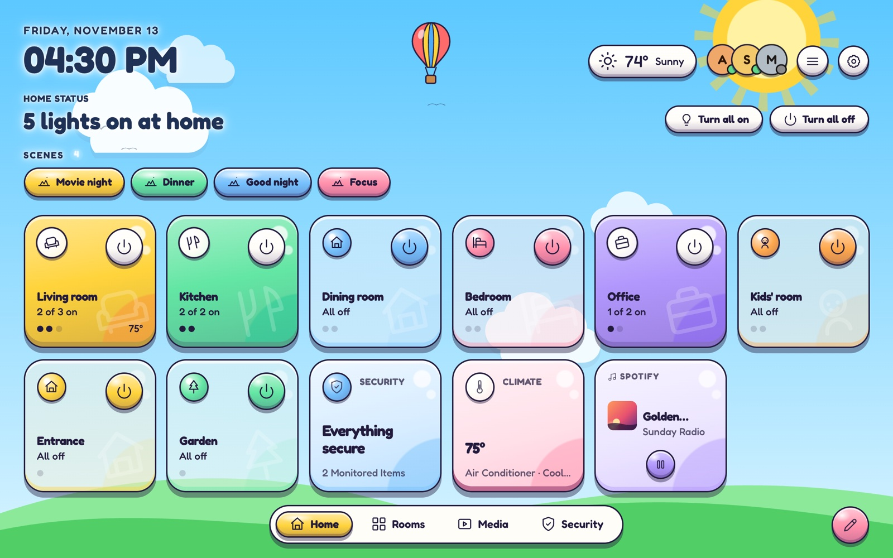
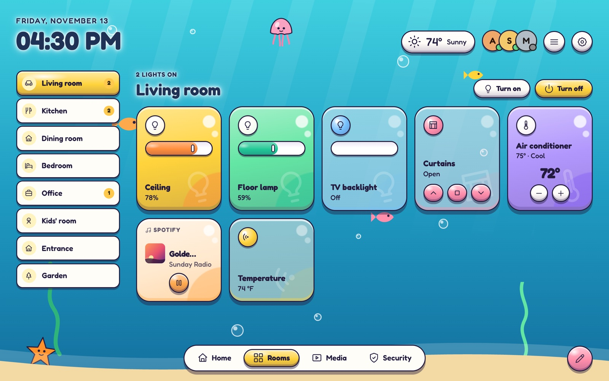
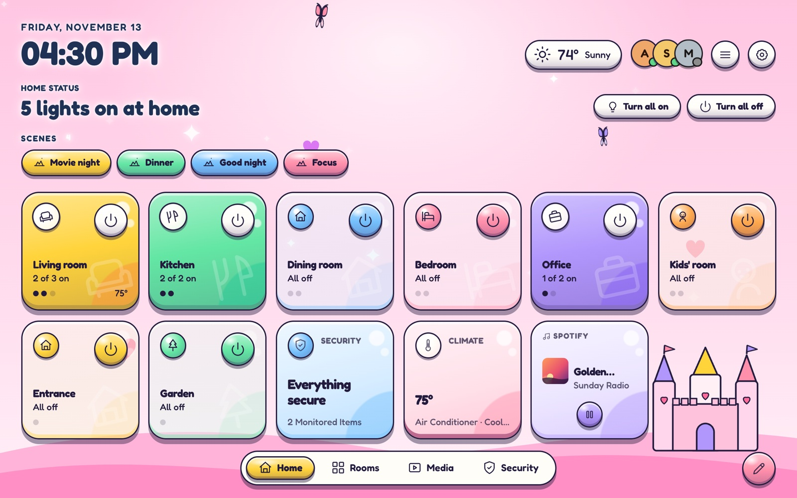
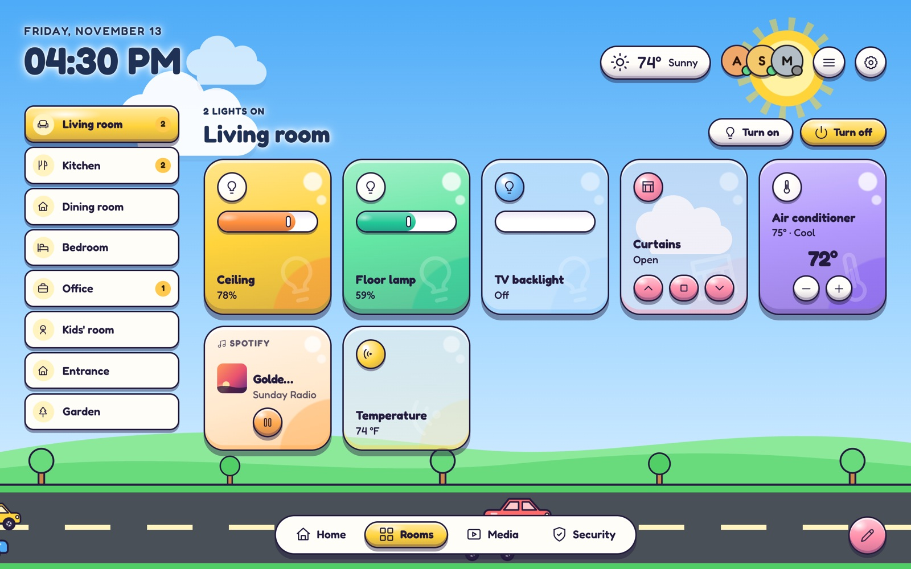

# HomeDeck

<p align="center"></p>

<p align="center"><b>A beautiful, local dashboard for Home Assistant that builds itself.</b><br>
No YAML, no cards to configure: add a light to an area and it shows up in the right room.</p>

<p align="center">
<a href="https://my.home-assistant.io/redirect/hacs_repository/?owner=rodrigo-wa&repository=homedeck&category=integration"></a>
</p>

<p align="center"><a href="https://homedeck.pro">Website</a> · <a href="https://homedeck.pro/video/homedeck-en.mp4">1-minute video</a> · <a href="https://github.com/rodrigo-wa/homedeck/blob/main/CHANGELOG.md">What's new</a></p>

HomeDeck reads your `Areas → Devices → Entities`, organizes your home by room and keeps every
setting and command inside Home Assistant.

**Designed by people, built with AI.** HomeDeck is designed, tested and maintained by an attentive,
committed team led by Rodrigo, who decide every feature, listen to the community and answer support.
The code is written with the help of AI (Claude), which speeds the work up a lot: with people
operating everything up close, fixes and new features ship much faster, often just days after
someone suggests them.

## A look inside

### Five layouts, one home

| Grid | Sidebar |
|:---:|:---:|
|  |  |
| **List** | **Focus** |
|  |  |

### Kids layout

A playful look for the kids' room or the whole family: chunky colorful cards, rounded letters,
bouncy animations and six animated scenes (Sky, Ocean, Space, Candy, Enchanted and Road). Each
tablet can have its own layout and scene, so the kids' room can play while the living room keeps
the Grid.

| Sky | Ocean |
|:---:|:---:|
|  |  |
| **Enchanted** | **Road** |
|  |  |

### Special dates

HomeDeck dresses up for the holidays on its own: a countdown by the clock, a light animation and
decorations on the cards, following your country. Each date can be turned on or off.

| Christmas | New Year |
|:---:|:---:|
|  |  |
| **Halloween** | **Birthdays from your calendar** |
|  |  |

Easter, Valentine's Day, Carnival, Thanksgiving and your own dates too.

### Your colors, your style

| Aurora | Ocean |
|:---:|:---:|
|  |  |
| **Wine** | **Graphite** |
|  |  |

### Arrange it your way

| Edit mode | Big cards |
|:---:|:---:|
|  |  |

### More than switches

| Sensor charts | Plants and readings |
|:---:|:---:|
|  |  |
| **Calendar and reminders** | **Forecast** |
|  |  |

### Screensaver and phone

<p align="center">  </p>

## Install with HACS

1. In Home Assistant, open **HACS**.
2. From the **⋮** menu, choose **Custom repositories**.
3. Enter `https://github.com/rodrigo-wa/homedeck` with the category **Integration**.
4. Search for **HomeDeck**, open it and tap **Download**.
5. Restart Home Assistant.
6. Go to **Settings → Devices & services → Add integration** and add **HomeDeck**.
7. Open **HomeDeck** in the sidebar and finish the first-run setup.

Requires Home Assistant 2024.7 or newer. Works on Home Assistant OS, Supervised, Container
and Core.

### Manual install

1. Download `homedeck.zip` from the [latest release](https://github.com/rodrigo-wa/homedeck/releases/latest).
2. Extract it into `/config/custom_components/homedeck`.
3. Restart Home Assistant and add the integration as in step 6 above.

### Updates

HACS shows new versions. Download the update and restart Home Assistant. If the old
interface still shows, do a full browser refresh (`Ctrl + Shift + R`, or `Cmd + Shift + R`
on macOS). Your rooms, backgrounds and preferences are kept.

## What you get

- **Five layouts:** Grid, Sidebar, List, Focus and Kids. Every screen, including Media,
  Security, Scenes and your own pages, follows the one you pick, and each tablet can have its own.
- **Bring your dashboard:** import a Home Assistant dashboard you already have, during setup or
  later. Each tab becomes a HomeDeck screen with the same devices in the same order, and the rooms
  can show only what's in it.
- **Edit mode, arranged your way:** drag to reorder, tap − to hide, add devices from any room,
  make a card double or large, split a screen into groups with separators and reorder the bottom
  bar. Nothing is ever deleted from Home Assistant.
- **Your names and icons:** rename devices and rooms inside HomeDeck, pick each room's and
  device's icon (or use Home Assistant's) and the sensor that shows a room's temperature. Home
  Assistant keeps its own names.
- **Protected cards:** ask for a second tap before switching a device, so a brush against the
  screen does nothing.
- **Devices inside a card:** double and large cards can hold up to 2 extra devices (a washer's
  Start button next to its program, a cover next to the room's lights).
- **Visibility rules:** show a card or a notice only when it matters: a device on or off, a sensor
  above or below a value, someone home, day or night, a time window and chosen days.
- **Who can see:** pick which people see each card or room (it controls what shows in HomeDeck, not
  Home Assistant permissions).
- **Calendar and reminders** beside the clock, with a full-screen month view and a
  reminders list, plus an optional **Today card** on Home.
- **Full weather forecast:** next hours and next 7 days, using your Home Assistant weather
  service, with Open-Meteo as a fallback for your home's location.
- **Big cards** with brightness, colors, light effects, a vertical cover control and a climate ring,
  plus a **small size** for sensors, half the height of a normal card.
- **Media artwork** for Apple TV, Sonos, Chromecast and other players, with their favorites
  and sources one tap away, and a full **player** for every media player on Pro.
- **Cameras** with live video right on the card and a full live view, a **Cameras screen** with
  16:9 cells and 1 to 4 per row, camera pages with your own layouts, 6× and 8× camera cards and an
  option to show the whole picture. Plus **vacuums** with their controls, and **scripts, buttons and
  selects** (like a washing machine program) right on the dashboard.
- **Alarm panels** to arm and disarm (with the code when the panel asks for one, and the open
  sensors with "Arm anyway" when Alarmo refuses), a **waste collection card** and **plants**
  from Plant Monitor/OpenPlantbook with their moisture, light and more. Both appear only once
  you add them in Edit mode.
- **History charts** in sensor details (and, optionally, right on double and large sensor cards),
  **camera full screen** including WebRTC-only cameras like newer Nest, and optional **weather, sun
  and energy cards** on Home (consumption, solar, grid and battery).
- Optional **animations:** fans spin, lights glow and washing machines shake while they run.
- **Special dates:** presents and string lights at Christmas, fireworks at New Year, a spider at
  Halloween, a bunny at Easter and balloons on birthdays from your calendar, following your
  country. Each one optional, with a preview in Settings.
- **Notices in the header:** pick any entity (a mailbox, the garage door, the doorbell) and it
  shows up beside the people only when there's something to notice, as an icon, text or both,
  with your own text.
- **Doorbell pop-up:** when the doorbell rings, its camera shows up over the panel, even on the
  screensaver.
- **Spotify player** (with a default speaker per device), a screensaver with today's events and reminders, scene strip,
  and, for a wall tablet, options to hide the Home Assistant sidebar, lock editing, a child lock for
  the cards you choose and keep the screen on (automatic on an Echo Show).
- **English, Portuguese, Spanish, German and Polish**, following Home Assistant's language.

## Plans

- **Free:** up to 4 rooms and 10 controllable devices (lights, switches, fans, covers,
  climate, media and locks). Sensors and scenes don't count. Grid and List layouts.
- **Pro:** unlimited rooms and devices, all five layouts (the Kids layout included), double and large cards, your own pages,
  the energy card, animations, sensor charts on cards, the doorbell pop-up, special dates, the full media player, the small sensor size,
  camera pages and big camera sizes, devices inside cards, visibility rules, who can see, the waste
  collection card, the screensaver with
  today's agenda, every background and color, the style (corners, frame and glass) and feedback
  straight to support. US$ 14.99 once or
  US$ 7.99 per year, per home (R$ 59.90 or R$ 29.90 per year in Brazil).

Buy Pro from **Settings → Plan** in the dashboard. The license is checked locally and
covers one Home Assistant installation; an online check every 7 days looks for renewals,
with 30 days of grace without internet. If your home outgrows Free, you choose what stays
on the dashboard; nothing is deleted, and everything comes back with Pro.

## Privacy

HomeDeck stores only interface choices, in `.storage/homedeck.config`. States, history,
cameras, passwords and tokens are never saved. The dashboard talks only to your Home
Assistant, plus the license server at `homedeck.pro` when you buy or renew Pro, and
Open-Meteo when no weather service is available.

## Troubleshooting

- **No temperature or forecast:** check **Settings → Weather**, pick a weather
  entity, and make sure it offers a forecast.
- **Long press doesn't open details:** keep your finger on the body of the card, not on a
  button or slider.
- **Old interface after updating:** do a full browser refresh.

## Development

```bash
cd frontend
npm install
npm run typecheck
npm run build
```

The build writes `custom_components/homedeck/frontend/homedeck-panel.js`, which is
committed. The **Validate** workflow fails if it doesn't match the source.

## Support and license

Questions, moving to a new home or refunds: [suporte@homedeck.pro](mailto:suporte@homedeck.pro).
Bugs: [issues](https://github.com/rodrigo-wa/homedeck/issues).

HomeDeck is source-available under the [HomeDeck License](LICENSE): free to install, use,
fork and change for your own home, not to redistribute, sell or modify to unlock Pro.
Changes: [CHANGELOG.md](CHANGELOG.md).

HomeDeck is an independent project, not affiliated with Home Assistant, Nabu Casa or the
Open Home Foundation.
